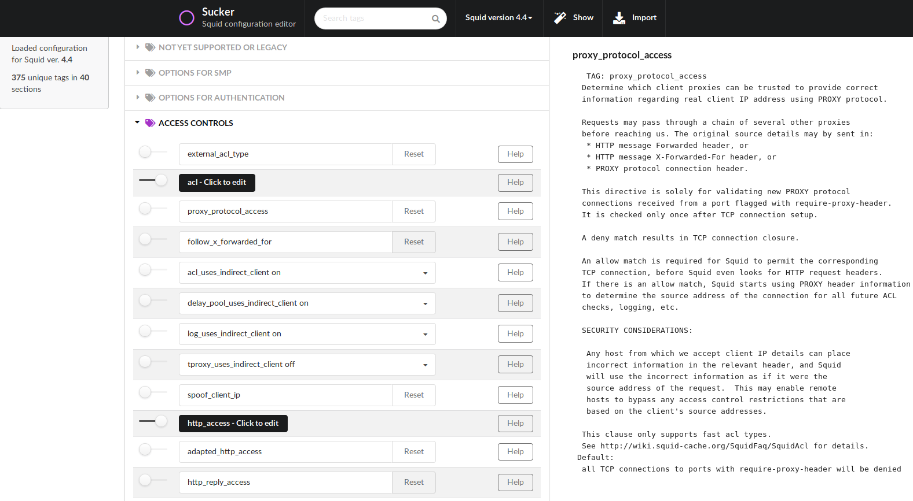

# Sucker

Visual editor and migration tool for new or existing Squid proxy configuration files.



## Features

- **Multi-Version Support**: Works with Squid configuration files from versions 2.x through 7.x
- **Visual Configuration Editor**: Interactive web-based interface for editing Squid configurations
- **Search & Filter**: Quickly find configuration directives by searching over tags
- **Configuration Import**: Import and parse existing `squid.conf` files
- **Version Migration**: Seamlessly migrate configurations between different Squid versions
- **Configuration Preview**: View generated configuration in real-time before applying
- **Enable/Disable Directives**: Toggle configuration options on/off without deleting them
- **Context-Sensitive Help**: Built-in documentation for each configuration directive
- **Custom Templates**: Add your own Squid configuration templates
- **Organized Sections**: Configuration directives grouped by functional categories
- **Multi-line Editor**: Dedicated editor for complex multi-line configuration values

## Architecture

Sucker is a full-stack web application consisting of:

- **Frontend**: React-based UI with TypeScript and Semantic UI React components
- **Backend**: Python-based REST API using Bottle framework and Gunicorn server
- **Parser**: Custom Squid configuration file parser supporting multiple versions

### Technology Stack

**Frontend:**
- React 19.2.3
- TypeScript 5.7.3
- Semantic UI React 3.0.0-beta.2
- Vite 7.3.0 (build tool)
- React Error Boundary 6.0.1

**Backend:**
- Python 3.12+
- Bottle 0.13.4 (web framework)
- Gunicorn 23.0.0 (WSGI server)
- simplejson 3.20.2

## Installation

### Using Docker (Recommended)

```shell
docker pull itworks99/sucker
docker run -d -p 3000:3000 itworks99/sucker
```

### Local Installation (Debian/Ubuntu)

#### Prerequisites
```shell
sudo apt-get install git python3 python3-pip nodejs yarn -y
```

#### Setup
```shell
git clone https://github.com/itworks99/sucker.git
cd sucker
```

#### Install Dependencies
```shell
# Install Python dependencies
pip3 install -e srv/

# Install Node.js dependencies
yarn install

# Build frontend (optional - pre-built version included)
yarn build
```

#### Run Application

**Production Mode:**
```shell
python3 srv/sucker.py
```
The application will start on `http://localhost:3000`

**Development Mode:**
```shell
# Start both backend and frontend in development mode
yarn dev:full

# Or start them separately:
# Terminal 1 - Backend (port 8000)
yarn backend

# Terminal 2 - Frontend (port 3000)
yarn dev
```

## Development

### Available Scripts

```shell
# Start both backend and frontend in dev mode
yarn dev:full

# Start only Vite dev server (port 3000)
yarn dev

# Start only backend server (port 8000)
yarn backend

# Build production frontend
yarn build

# Preview production build
yarn preview

# Run ESLint
yarn lint

# Run unit tests
yarn test

# Run tests with UI
yarn test:ui
```

### Project Structure

```
sucker/
├── src/              # React + TypeScript frontend source
│   ├── index.tsx     # Entry point
│   └── sucker.tsx    # Main component
├── srv/              # Python backend
│   ├── sucker.py     # Main production server
│   ├── parser.py     # Config parser
│   ├── config.py     # Configuration
│   └── templates/    # Squid config templates
├── run_backend.py    # Development backend server
├── build/            # Built frontend assets
└── public/           # Static assets
```

### API Endpoints

- `GET /json` - Retrieve default configuration
- `GET /version` - Get version-specific configuration
- `POST /import` - Import existing Squid configuration
- `GET /` - Serve frontend application

## Usage

Once installed, navigate to `http://localhost:3000/` in your web browser.

### Adding Custom Squid Config Templates

1. Locate your `squid.conf` file
2. Copy it to `srv/templates/` with the naming format: `squid[version].conf`
   - Example: Squid 4.4 → `squid44.conf`
   - Example: Squid 6.13 → `squid613.conf`
3. Restart the application:
   - **Docker**: Rebuild image and restart container
   - **Local**: Restart `python3 srv/sucker.py`

## License

MIT License – See [LICENSE.TXT](LICENSE.TXT) for details

## Contributing

Please see [CONTRIBUTING.md](CONTRIBUTING.md) for contribution guidelines
